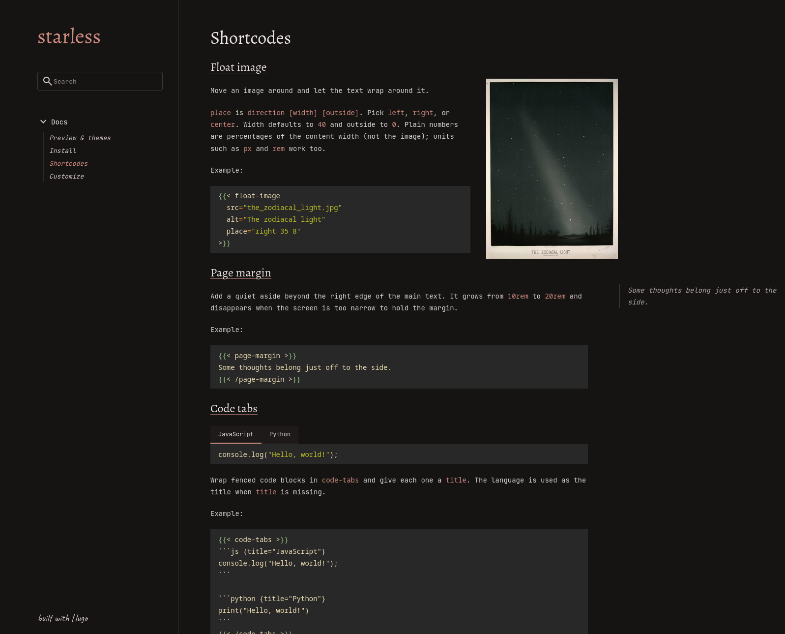
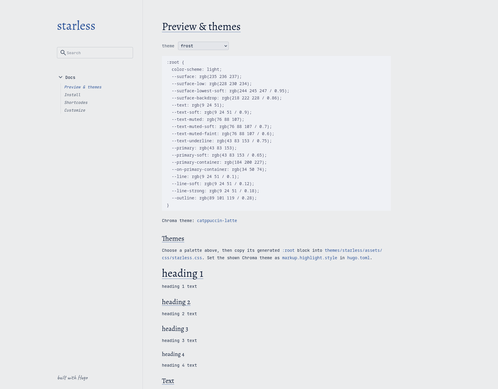
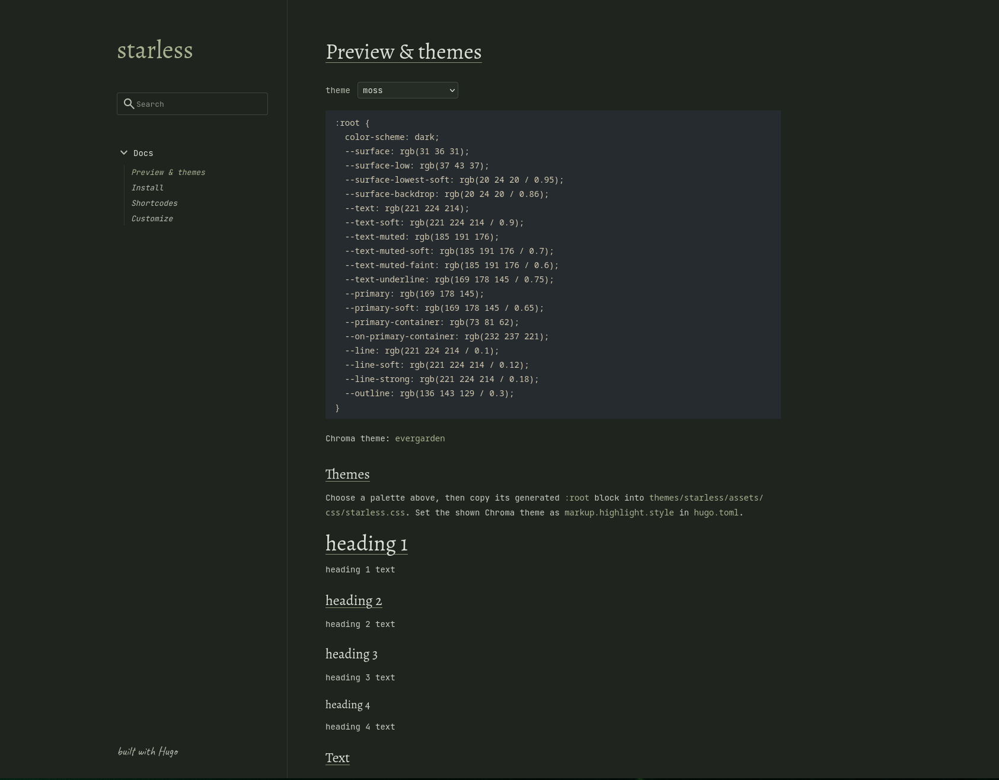
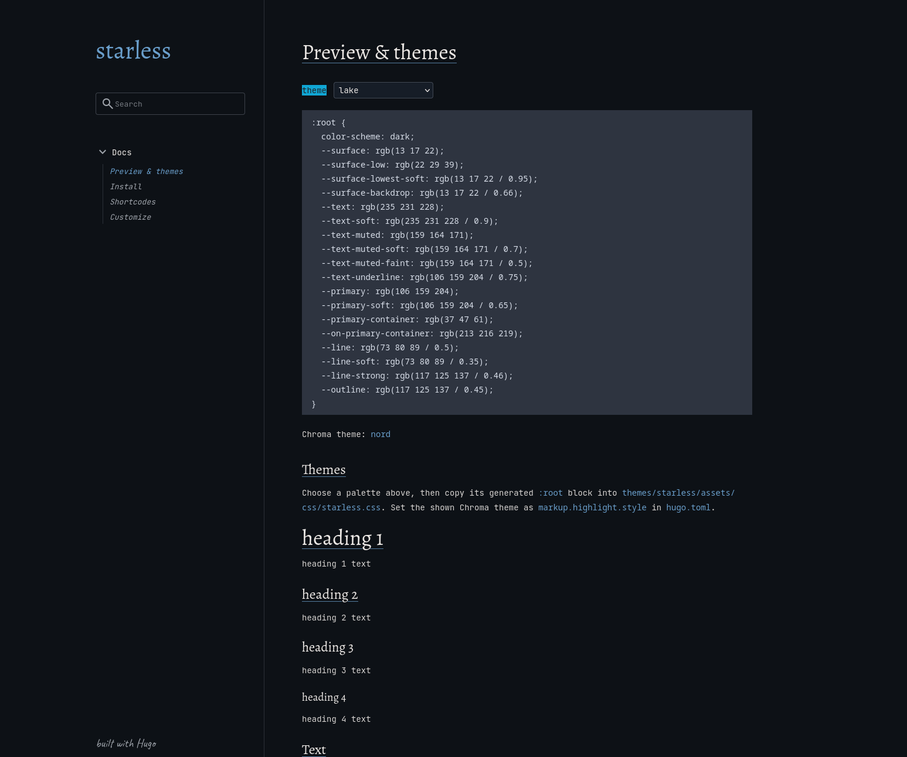

# starless

> **Archived**: I'm forked off and continued development in a private repo. It's a good theme, not great, but given no one really uses it, it does not justify the effort on my end to keep this "generic".
> I would rather just drop anything that I don't use, and modify inline what I need instead of exposing options or documenting stuff.

a minimal hugo theme

see it here: [starless.ruiny.de](https://starless.ruiny.de/)

## install

Create a Hugo site if you don't have one:

```sh
hugo new site my-blog-name
cd my-blog-name
```

Clone the theme into your site:

```sh
git clone https://github.com/ruinivist/hugo-starless themes/starless
```

Add this to `hugo.toml`:

```toml
theme = "starless"

[outputs]
home = ["HTML", "RSS", "JSON"]
```

The JSON home output powers search. Then run:

```sh
hugo server
```

For config, see [customize](https://starless.ruiny.de/docs/customize/).

For a preview and themes, see [preview & themes](https://starless.ruiny.de/docs/how-it-looks/).

## screens








